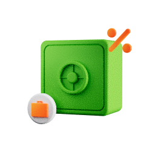
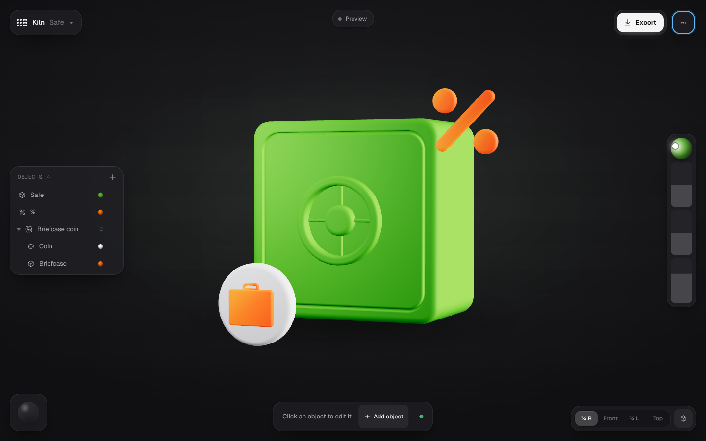
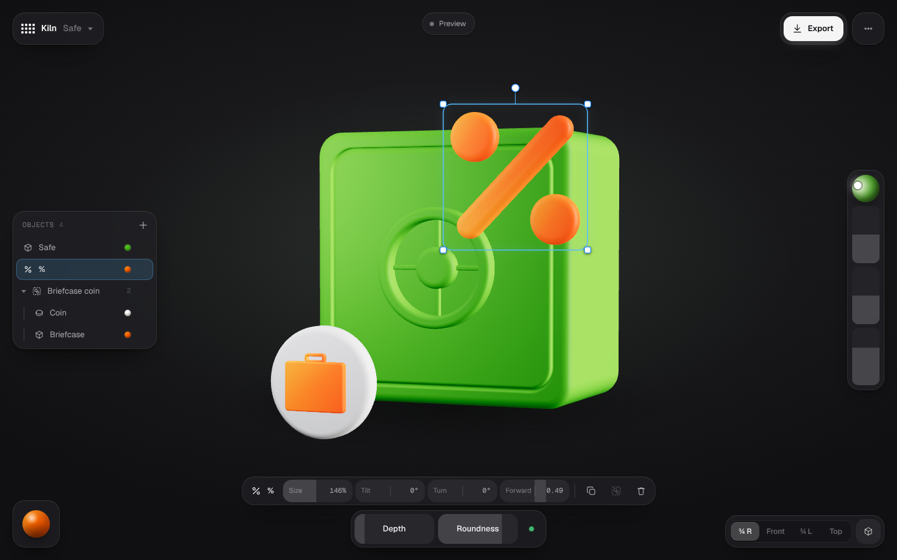
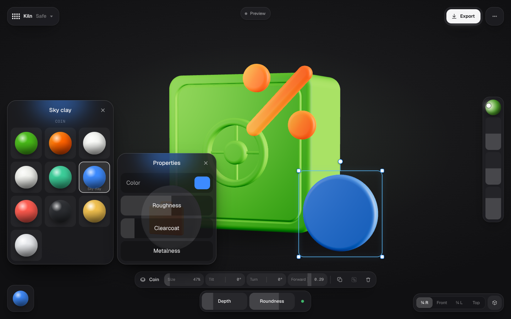
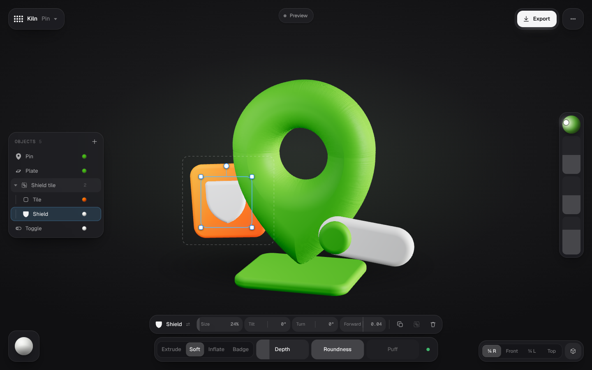
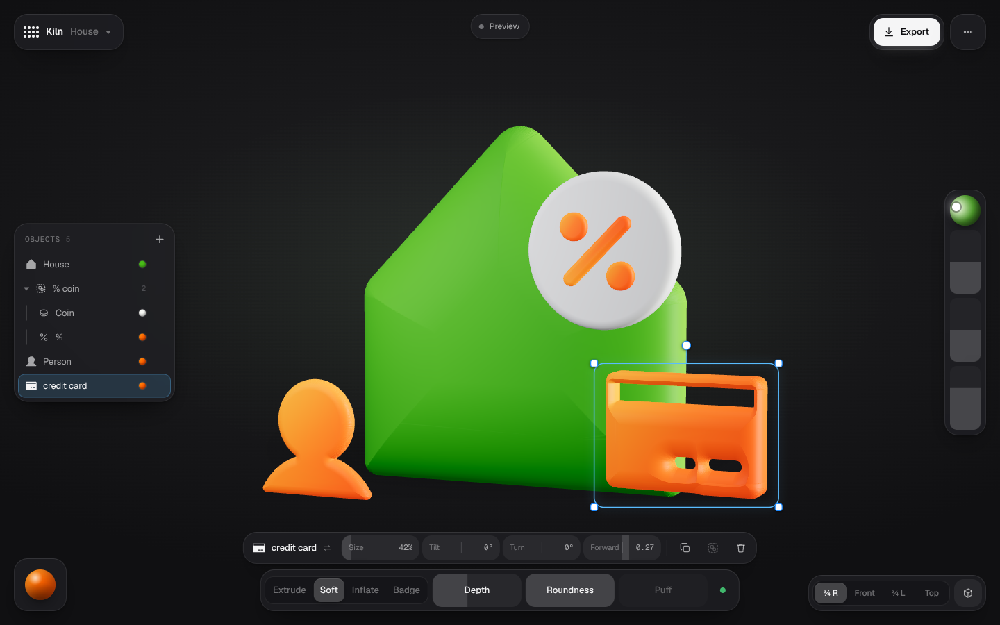
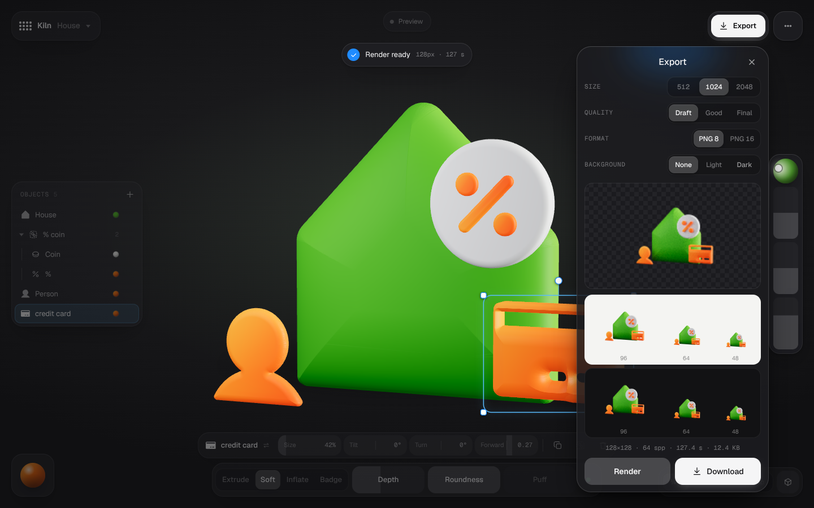

# Kiln

Форма или SVG → 3D-композиция в стиле Green clay → PNG для продукта. Собран на Maga UI: объект в центре, управление в стеклянных островах по краям.

Композиция — это набор отдельных объектов: иконки, монеты, бейджи, плитки, тумблеры, плиты, знак %, готовые модели (сейф, портфель). Каждый объект двигается, масштабируется, поворачивается, меняет форму и материал сам по себе; несколько объектов собираются в группу и двигаются вместе.

## Запуск

```bash
cd apps/kiln
npm install
npm run dev        # localhost:5173
```

Нужен браузер с WebGPU: Chrome 121+ или Safari 26+. Без WebGPU работает растровое превью, экспорт недоступен.

Страницы:
- `/` — приложение;
- `/lookdev.html` — стенд look-dev: рендер примера и цвета в контрольных точках;
- `/spike.html` — замеры Phase 0.

## Как устроено

| Остров | Что делает |
|---|---|
| Слева вверху | Kiln + меню: примеры Safe, House, Pin; пустая сцена; новая сцена из иконки или своего SVG |
| Сверху по центру | Статус вьюпорта: Preview → Tracing · N spp → Traced |
| Справа вверху | Export: размер 512/1024/2048, Draft 64 / Good 256 / Final 384 spp, PNG 8/16, фон, превью, QA-полоска 96/64/48 px на светлом и тёмном, скачивание |
| Слева по центру | Objects: все объекты и группы сцены. Клик выделяет, Shift или ⌘ добавляет, двойной клик переименовывает, глаз скрывает. «+» добавляет иконку (36 банковских + поиск по 1 512 Phosphor), своё SVG, монету, бейдж, плитку, тумблер, плиту, % |
| Снизу по центру | Панель выделения: Size, Tilt, Turn, Forward; Duplicate, Group / Ungroup, Delete. Под ней док по типу объекта: у иконки Extrude · Soft · Inflate · Badge и Depth / Roundness / Puff, у монеты, плитки, плиты, тумблера и % — Depth и Roundness |
| Слева внизу | Материалы выделенного: слоты объекта (Coin / Icon у бейджа, Track / Knob у тумблера), библиотека, цвет, шероховатость, лак, металл. У нескольких объектов свотч ложится на основной слот каждого |
| Справа | Свет: шар — направление ключевого света, Intensity, Softness, Warmth |
| Справа внизу | Ракурс ¾ R / Front / ¾ L / Top, орто-камера |

**Вьюпорт.** Клик по объекту выделяет его, а если объект в группе — всю группу; двойной клик заходит в группу и выделяет сам объект. Тащить объект — двигать в плоскости экрана, точка под курсором остаётся под курсором; Shift — только по одной оси, Alt — тащить копию. Угловые ручки масштабируют, ручка сверху наклоняет (Shift — шаг 15°). Клик в пустоту снимает выделение, тащить пустоту — орбита с инерцией, двойной клик в пустоту — вернуть ракурс. Пока тянешь, камера стоит; после отпускания плавно перекадрирует композицию.

Растр, пока что-то двигается; через 300 мс тишины включается path tracing до 64 spp. Перемещение и скрытие объектов не пересобирают BVH трейсера, только обновляют матрицы (`updateTransforms`); пересборка — когда меняется геометрия.

**Горячие клавиши.** ⌘Z / ⇧⌘Z отмена и повтор, ⌘D дублировать, ⌘G / ⇧⌘G группа и разгруппировать, ⌘A всё, Delete удалить, стрелки двигать (Shift ×10), `[` `]` ближе и дальше, Esc выйти из группы и снять выделение. A добавить, S иконка (заменить у выделенной иконки), O своё SVG, E экспорт, M материалы, H скрыть интерфейс, R сбросить вид, 1–4 ракурсы, P орто.

**Устройство.** Сцена — JSON-документ (`src/doc/scene.ts`): объекты с трансформом, формой и материалами по слотам, группы в один уровень. Все правки идут через редактор (`src/app/editor.ts`): одно действие или один жест — один шаг отмены, история — снимки документа. `SceneRuntime` (`src/doc/runtime.ts`) сверяет документ с three.js по id и сообщает, что поменялось: только матрицы, только материалы или геометрия. Меши иконок печёт воркер: превью сразу, точный меш через 700 мс тишины; пока идёт выпечка, новые значения слайдера копятся, печётся только последнее.

## Look-dev Green clay

Цель — чтобы дефолтный пример выглядел как референсы (сейф, дом, пин). Замерено на `images/7.webp` (2000²).

**Тональная кривая — ACES Filmic, а не Standard.** Один альбедо зелёного под ACES объясняет все точки референса с ΔE76 ≈ 1.9. Под Standard остаток 7.8, светлые боковые грани не сходятся: им нужна десатурация, которую даёт только filmic-кривая. AgX не подходит совсем (15.4). Экспорт и превью используют ту же ACES, что `THREE.ACESFilmicToneMapping`. Standard остался переключателем в настройках — для серебряного гайда.

**Свет.** Риг привязан к камере, поэтому любой ракурс и любая иконка набора освещены одинаково:
- ключ — прямоугольный area light близко к объекту, слева сверху (−60°, 20°, 1.4 радиуса): даёт диагональный градиент на фронтальных гранях;
- боковая и верхняя панели — в environment: правая грань ровно светлая, как в рефах;
- купол — слабая заливка теней.

Интенсивности подобраны по разложению: белые проходы по каждому источнику отдельно, затем подбор весов под целевую освещённость в контрольных точках.

**Материалы.** Зелёный `#49BC18` (линейный 0.066 / 0.5 / 0.0095), шероховатость 0.55, слабый спекуляр и лак — иначе белая дымка гасит насыщенность. Монета почти белая `#F3F5F1`. Оранжевому градиенту добавлено лёгкое свечение: в рефах акценты освещены сильнее, чем позволяет общий риг.

**Сверка с референсом** (`tests/e2e/lookdev.mjs`, рендер 256² · 48 spp, медиана окна вокруг точки):

| Точка | Референс | Kiln | ΔE00 | ΔE76 |
|---|---|---|---|---|
| Фронт, верх-лево | `#79D037` | `#78C849` | 3.0 | 10.5 |
| Фронт, центр | `#45B217` | `#41A424` | 4.4 | 10.1 |
| Фронт, низ-право | `#269009` | `#208C0C` | 1.6 | 2.4 |
| Правая грань | `#9ADD5B` | `#9DDD5D` | 0.4 | 1.4 |
| Монета | `#E3E5E2` | `#D8D5D7` | 5.4 | 6.1 |
| Точка % | `#FD6500` | `#F06722` | 3.0 | 11.6 |
| Портфель | `#FF7100` | `#F67321` | 2.3 | 9.4 |

Среднее ΔE00 2.9, максимум 5.4 (цель — до 10). На 384² · 64 spp до последней правки акцентов: среднее 4.0, максимум 6.9. После перевода Safe на документ сцены (Phase 1b): среднее 2.8, максимум 4.9 — в пределах шума.



## Скриншоты








## Ограничения

- «Объединить» — это группа, как в Figma: объекты остаются отдельными мешами со своими материалами и двигаются вместе. Булева склейка в один меш не делается.
- Группы в один уровень: группа из групп сливает их детей в одну.
- Сейф и портфель — готовые модели: размер, поворот и материал меняются, форма нет.
- Сцена живёт до перезагрузки страницы: автосохранения пока нет.

## Совместимость

- **Dawn и 3D storage-текстуры.** Chromium 141 лениво очищает 3D storage-текстуру через 2D-вью и падает на LUT трейсера. `src/render/compat.ts` заполняет такие текстуры нулями при создании. Раньше тесты обходили баг флагом `--disable-dawn-features=lazy_clear_resource_on_first_use`, но флаг оставлял всю GPU-память неинициализированной, и трейсер копил мусор (миллионы и отрицательные значения). Флаг убран.
- **three r185+ и swizzle** — тот же шим, без изменений.
- Один area light: трейсер выбирает источник на каждый отскок, дальние панели в environment сходятся быстрее.

## Проверки

```bash
npm test              # vitest: мешер, sweep-геометрия, риг, тональная кривая, документ, рантайм, манипуляции
npm run typecheck
npm run build
node tests/e2e/app.mjs        # редактор: выбор и перетаскивание во вьюпорте, масштаб, отмена, добавление, группы, материал одного объекта, экспорт
node tests/e2e/lookdev.mjs --ref <путь к 7.webp> --size 384 --spp 64
```

E2E идут в Chromium с WebGPU на SwiftShader (CPU), поэтому медленно: экспорт 128² · 64 spp ≈ 2 мин.

## Что дальше

- Сохранённые стили и автосохранение сцены, текст, привязки и направляющие при перетаскивании.
- Phase 2: серебро и оранжевое стекло по гайду (нужны `bank-illustrations.blend` и эталонные PNG), Concave, 4096².
- Проверить скорость на реальном GPU: 2048² · 256 spp в Chrome и Safari.
