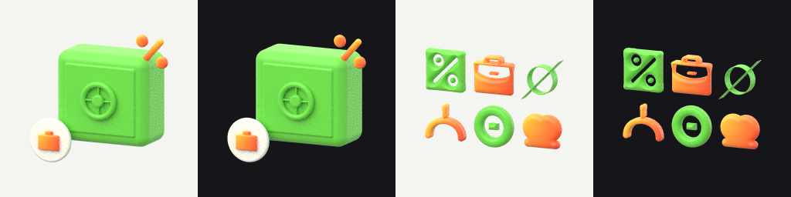
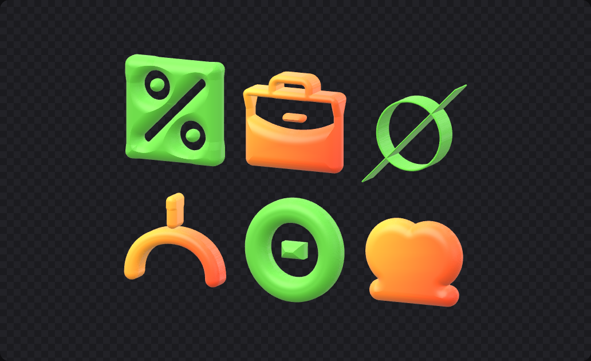

# Kiln — Phase 0 spike

Цель: до UI проверить два риска. Первый: экспорт path-traced PNG с прозрачным фоном из браузера. Второй: устойчивый SVG → 3D на любых SVG. Код spike — основа для Phase 1, а не прототип на выброс.

Открыть: `npm run dev` → `/spike.html`. Кнопки Render, PNG 8, PNG 16, Mesher suite.

## Итог

**Gate пройден в контейнере, нужна проверка на реальном GPU.** Экспорт, прозрачность, орто-камера, PNG 16-bit и мешер на шести сложных SVG работают. Скорость на настоящей видеокарте и поведение в Safari 26 и свежем Chrome здесь проверить нельзя: в контейнере WebGPU эмулируется на CPU (SwiftShader).

## Рендер

| Проверка | Результат |
|---|---|
| Движок | `WebGPUPathTracer` (three-gpu-pathtracer 0.0.27). WebGL-версия в пакете deprecated |
| three | 0.185.1, версия, под которую собран path tracer. 0.186 ведёт себя так же |
| Прозрачный фон | ✅ альфа в углах 0, на выходе float RGBA со straight alpha |
| Орто-камера | ✅ near/far считаются по вершинам объекта (`fitOrtho`) |
| Ориентация readback | ✅ без flipY, совпадает с превью |
| PNG 8 / 16 bit | ✅ `fast-png`, проверено декодированием: размер, глубина, 4 канала, прозрачные углы |
| NaN в буфере | 0 |
| Свет | Процедурная студия в environment map: купол + софтбоксы (key, fill, top strip, rim). Path tracer сэмплирует её через importance sampling, поэтому шум уходит быстро. Rect/circle area lights в трейсере тоже есть, понадобятся для гайда v7 |
| Риг следует за камерой | `scene.environmentRotation.y = azimuth`, трейсер это учитывает |

Время в контейнере (SwiftShader, CPU):

| Кадр | Время |
|---|---|
| 32² · 1 spp | 7.5 с, почти всё — компиляция пайплайнов и BVH |
| 128² · 4 spp | 12.6 с |
| 256² · 32 spp | 124 с |

Сцена слева собрана из примитивов по референсу «сейф + % + монета с портфелем». Справа шесть сложных SVG после мешера. Шум уйдёт на финальных 256–384 spp.

### Совместимость, найденная по пути

1. **three r185+ передаёт `swizzle: 'rgba'`** в `createView`. Chromium ≤141 падает на каждом кадре. Шим `src/render/compat.ts` убирает identity-swizzle, это поведение по умолчанию, так что на новых браузерах ничего не меняется.
2. **Dawn в Chromium 141 лениво очищает 3D float storage-текстуры через 2D-вью**: ошибка валидации на LUT трейсера (Turquin, 32×32×31). В тестовом браузере это обходится флагом `--disable-dawn-features=lazy_clear_resource_on_first_use`. **Нужно проверить в актуальном Chrome и Safari.** Если там повторяется, придётся прогревать LUT записью до первого compute.

## Мешер

SVG → DOMPurify → `` → OffscreenCanvas (coverage, 2048 px по длинной стороне) → subpixel EDT (подход TinySDF) → локальная полуширина (max-фильтр) → implicit-профиль rounded extrusion (extrude / soft / inflate) → **manifold surface nets** (вершина на каждую связную компоненту в ячейке) → проекция Ньютона и нормали из градиента → meshoptimizer (ошибка 3e-4).

Точность поля: у контура ошибка < 0.2 px, далеко от контура ≤ 2 %.

Шесть сложных SVG, режим soft, браузерный воркер в контейнере:

| SVG | field, мс | mesh 192 / 512, мс | simplify 512, мс | треугольники 512 (сырые → итог) | замкнут |
|---|---|---|---|---|---|
| percent (Phosphor) | 685 | 788 / 3066 | 5383 | 2 164 360 → 126 034 | ✅ |
| briefcase (Phosphor) | 1420 | 407 / 2088 | 3129 | 1 586 712 → 87 262 | ⚠️ 2 ребра после simplify, сырой замкнут |
| hairline (3 px stroke) | 1385 | 491 / 1685 | 3137 | 1 325 508 → 104 722 | ✅ |
| stroke-only | 606 | 291 / 1306 | 2002 | 873 184 → 81 462 | ✅ |
| even-odd (дырка + остров) | 1383 | 572 / 2149 | 2517 | 1 545 800 → 144 636 | ✅ |
| overlap (объединение) | 937 | 486 / 2176 | 1732 | 1 271 916 → 75 916 | ✅ |

Тонкие линии не пропадают: радиус скругления ограничен локальной полушириной формы. Дырки и острова сохраняются. Перекрытия сливаются, потому что браузер растеризует SVG сам.

**Бюджеты из плана не выполнены** (план: превью < 50 мс, финал ≤ 500 мс). В контейнере превью 0.3–0.8 с, финал 4–9 с. Решение для Phase 1:
- превью: сетка 192 без упрощения (растру 100–300k треугольников не мешают), с debounce на слайдерах;
- финал: 512 + simplify в фоне, после того как правки затихли; экспорт ждёт финальный меш;
- оптимизация: не генерировать плотные плоские крышки (сразу грубая триангуляция плоских зон). Это главный источник лишних треугольников и времени simplify;
- поле для превью строить на 1024 px.

Тесты: `npm test` (vitest, 9 тестов): точность поля, замкнутость / род / направление нормалей по всем режимам, тонкая линия, плоская крышка, скорость превью.

## Решения для Phase 1

- Только `WebGPUPathTracer`. Без WebGPU: растровое превью и помеченный Draft-экспорт.
- three и path tracer обновляются вместе; сейчас three 0.185.1.
- Свет Green clay — процедурная студия. Area lights подключаем в Phase 2 под риг гайда.
- Мешер как есть + плоские крышки + фоновый финальный bake.
- Материал монеты сейчас читается кремовым, а не серым: подстроить по референсам.

## Что нужно от тебя

1. Открыть spike на Mac в Chrome и в Safari, нажать Render с 2048 и 256 spp: сколько секунд и нет ли ошибок в консоли.
2. Для Phase 2: `source/bank-illustrations.blend` и PNG-эталоны из гайда.

## Файлы

- `src/render/` — `tracer.ts` (стиллы на точный размер, прогресс, отмена), `view-transform.ts` (clamp + sRGB, даунскейл в линейном premultiplied), `encode.ts` (PNG 8/16), `compat.ts`
- `src/geometry/` — `field.ts`, `profiles.ts`, `mesher.ts`, `simplify.ts`, `mesher.worker.ts`, `bake.ts`
- `src/shape/svg.ts` — санитайз и растеризация
- `src/scene/` — `environment.ts` (студия), `materials.ts` (Green clay), `camera.ts` (пресеты и fit), `primitives.ts`
- `src/spike/` — страница spike, сцена-реф из примитивов, набор сложных SVG
- `tests/unit/` — vitest; `tests/e2e/` — Playwright: `spike.mjs`, `mesher.mjs` (SwiftShader WebGPU)
