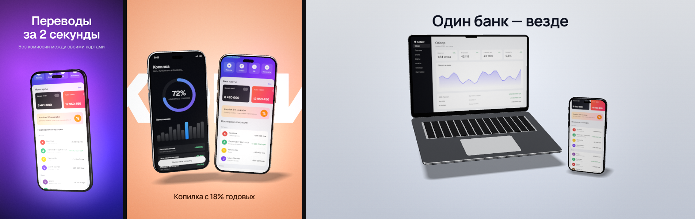
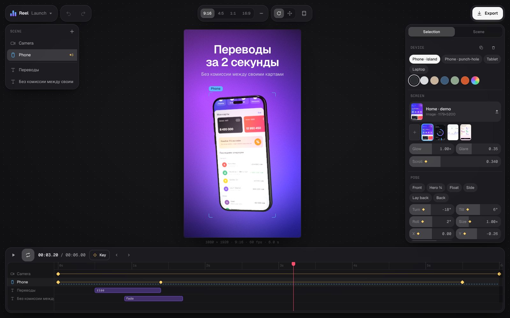

# Reel

3D-мокапы устройств и промо-ролики в браузере. Телефон, Android, планшет, ноутбук; свой скриншот, длинный скрин со скроллом или запись экрана; текст спереди или за устройствами; экспорт PNG и MP4 покадрово. Собран на Maga UI, three.js (WebGL) и WebCodecs.

Референс — [3dmockup.xyz](https://3dmockup.xyz). Там одна модель и слайдеры Rotation X/Y/Z, Position X/Y/Z, а ключи ставятся по каждому свойству отдельно из панели. Здесь всё это делается руками в кадре.




## Запуск

```bash
cd apps/reel
npm install
npm run dev        # localhost:5173
```

Кит берётся из `apps/kiln/src/ui/kit` через алиас `@kit`, поэтому рядом должна лежать папка `apps/kiln`.

## Управление

**В кадре**

| Жест | Что делает |
|---|---|
| Тащить устройство | Поворот: по горизонтали Turn, по вертикали Tilt. Shift — одна ось и шаг 15°, ⌥ — Roll |
| Space / правая кнопка / инструмент Move (G) + тащить | Двигать устройство в плоскости экрана; точка под курсором остаётся под курсором. Shift — одна ось |
| Тащить текст | Двигать, прилипает к центральным линиям кадра. Shift — без прилипания |
| Тащить пустое место | Орбита камеры. Shift — пан |
| Колесо / пинч | Долли камеры |
| ⌥ + колесо | Объектив, кадр сохраняется (dolly zoom): длиннее фокус — площе перспектива |
| Shift + колесо | Размер выделенного устройства |
| Перетащить файл на устройство | Картинка или видео на этот экран. ⌘V — вставить скриншот из буфера |

Во время жеста рядом с курсором — значения (Turn −26° · Tilt 8°) и ◆, если пишется ключ.

**Анимация**

- Ключ — снимок всего объекта (устройство или камера), а не одного свойства. На таймлайне одна строка на объект.
- K ставит первый ключ. Дальше ключи появляются сами: передвинь плейхед и поверни, сдвинь, поменяй размер или скролл экрана — на плейхеде появится ключ. Без ключей правки меняют статичную позу.
- Ключи на таймлайне: тащить — сдвинуть (прилипает к 0,05 с и к плейхеду, Shift — свободно), ⌥ + тащить — копия, двойной клик по строке — ключ в этой точке, двойной клик по ключу — плейхед на него, ⌫ — удалить.
- У ключа свой изинг прихода: Linear, Smooth, Out, Spring, Back, Hold. Форма ромба на таймлайне показывает изинг.
- Пресеты движения пишут обычные ключи, их потом правишь: Reveal, Drop in, Swing, Turntable, Flip, Scroll screen; у камеры Push in, Pull out, Orbit.
- Float и Spin — модификаторы поверх ключей. Считают целые циклы на клип, поэтому видео зацикливается без шва.
- У текста анимация появления (Fade, Rise, Blur, Type, Pop) — полоска на его строке: тащить — сдвинуть, правый край — длительность.

**Горячие клавиши.** Space — плей/пауза (если с зажатым Space тащили устройство — не переключает), ←/→ — кадр (Shift — секунда), J/L — предыдущий/следующий ключ, Home/End, K — ключ, 1–6 — позы, R/G — поворот/перемещение, S — безопасные зоны, T — текст, ⌘D — дубликат, ⌘Z/⇧⌘Z, ⌘S — сохранить проект, ⌘O — открыть, E — экспорт, H — скрыть интерфейс.

## Что внутри

| Остров | Что делает |
|---|---|
| Слева вверху | Проект: шаблоны Launch, Duo, Web + mobile, Store screenshot, Blank; открыть и сохранить проект (JSON со скринами внутри); отмена и повтор |
| Сверху по центру | Формат: 9:16, 4:5, 1:1, 16:9, App Store 6.9″, Play feature, свой размер. Инструмент для перетаскивания устройства, безопасные зоны сторис |
| Слева | Слои: камера, устройства, тексты; глаз, переименование двойным кликом, число ключей. Раскладка для нескольких устройств: Row, Fan, Cascade, Stack |
| Справа, Selection | Устройство: модель, отделка, экран (свой файл или демо), Glow, Glare, Scroll; позы; Turn, Tilt, Roll, Size, X, Y, Depth, крышка ноутбука; пресеты движения; Float, Cycles, Spin. Камера: планы, Lens, Distance, Orbit, Height, Roll, Pan. Текст: шрифт (все с кириллицей), насечка, размер, трекинг, интерлиньяж, цвет, выравнивание, спереди или за устройствами, анимация |
| Справа, Scene | Фон: Solid, Linear, Radial, Mesh, None и 12 пресетов, шум. Свет: Studio, Softbox, Strips, Dusk, интенсивность, поворот, тень, мягкость. Эффекты: Bloom, Threshold, Grain, Vignette. Длина клипа и fps |
| Снизу | Таймлайн |
| Справа вверху | Экспорт: MP4, WebM, PNG; ½×, 1×, 2×; 30 или 60 fps; PNG с прозрачным фоном |

**Рендер.** Один путь для превью и экспорта. Сцена рендерится в half-float таргет с MSAA. Металл и стекло проходят ACES внутри своих материалов, а экран и фон — мимо тональной кривой: цвета скриншота и брендовый фон попадают в кадр байт в байт. Дальше bloom (dual-filter, 6 мипов), композит с 2D-фоном и текстом, виньетка, зерно. Тени — VSM на невидимом полу под конечной позой устройств, чтобы тень не ездила во время движения.

**Экспорт** покадровый, не запись экрана: для каждого кадра сцена выставляется на `t = i / fps`, видео на экранах перематывается на этот момент, кадр уходит в WebCodecs (mediabunny). Движение ровное, даже если превью тормозит. MP4 — H.264, если браузер умеет, иначе HEVC, VP9 или AV1 в MP4.

**Документ** — JSON (`src/doc.ts`), каждая правка — шаг отмены, автосохранение в localStorage, загруженные картинки и видео — в IndexedDB.

## Что зафейкано

- Модели устройств процедурные, без брендов: остров, punch-hole, планшет, ноутбук. Это не точные копии конкретных телефонов.
- Демо-экраны (банк, копилка, бюджет, дашборд) нарисованы на canvas, данные выдуманы.
- Шаблон затирает текущую сцену без возможности отмены; сохраните проект перед этим.

## Ограничения

- Прозрачность только в PNG. Видео с альфой (WebM VP9 alpha) не сделано.
- Звука нет.
- Один уровень анимации текста: появление. Уход и ключи по позиции текста — нет.
- Ключи камеры и устройства интерполируют эйлеровы углы: Turntable на 360° работает, а резкие повороты через «полюс» (Tilt ±90°) могут крутиться не по кратчайшему пути.
- Экспорт 2× в 9:16 — это 2160×3840, H.264 на таком размере кодирует не каждый браузер; тогда берётся другой кодек или ½×/1×.

## Проверки

```bash
npm test             # vitest: изинги, интерполяция, автоключи, бесшовные модификаторы, пресеты
npm run typecheck
npm run build
npx vite --port 5180 &
node tests/e2e.mjs   # Playwright: поворот и перемещение в кадре, автоключ, отмена, перетаскивание ключа, изинг, текст со снапом, долли, PNG и MP4
```

E2E идут в Chromium на SwiftShader (CPU): медленно, rAF там ~1 fps, поэтому в тестах есть `reel.renderNow()`.
